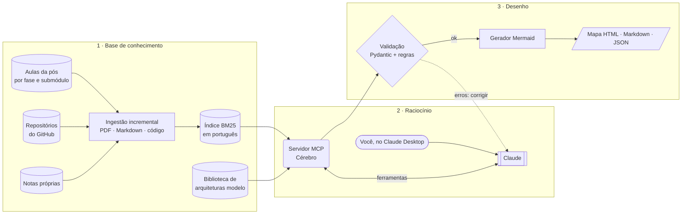

# Cérebro MLE

**Do problema de Machine Learning Engineering ao mapa de arquitetura, com roteiro de desenvolvimento e fontes.**

O Cérebro MLE é uma base de conhecimento local (RAG) conectada ao Claude Desktop por MCP. Você descreve um
problema ("preciso detectar fraude em tempo real", "como monitorar meu modelo de crédito") e recebe:

1. **O mapa da arquitetura**, com etapas agrupadas, componentes e fluxo, desenhado de forma determinística (sempre válido);
2. **Um roteiro em passos**, com a ordem de construção, o porquê de cada passo e o critério de pronto;
3. **As fontes**: em qual aula, fase e página, ou em qual projeto, cada decisão se apoia.

O raciocínio é feito pelo Claude, com a sua assinatura e sem custo de API. O conhecimento, a validação e o desenho
ficam no seu computador.



## Por que funciona bem

- **O LLM não desenha.** O Claude decide a arquitetura e devolve JSON; o Python valida (ids, etapas, ligações,
  roteiro) e gera o Mermaid. Se houver erro, o Claude recebe a lista exata e corrige.
- **Exemplos reais.** A biblioteca traz 9 arquiteturas modelo validadas, 3 delas tiradas dos projetos do autor
  (DriftGuard, Triagem de Laudos, Churn). Com bons exemplos, os mapas novos saem consistentes.
- **Fontes rastreáveis.** Cada trecho buscado ganha uma etiqueta (`F-3fa2c1`) que o roteiro cita; o mapa lista
  aula, fase e página.
- **Leve.** A busca BM25 roda instantaneamente em qualquer PC, sem GPU e sem baixar modelos.

## Instalação (Windows)

Pré-requisitos: Python 3.10+, Git e o app Claude Desktop.

1. Coloque os PDFs das aulas em `data/aulas/<fase>/<submódulo>/` (veja `data/aulas/LEIA-ME.md`).
2. Dê dois cliques em **`instalar.bat`**. Ele cria o ambiente, baixa seus repositórios, indexa tudo, gera os
   mapas de exemplo e registra o Cérebro no Claude Desktop.
3. Feche o Claude Desktop por completo (inclusive na bandeja do sistema) e abra de novo.

No Claude, peça por exemplo:

> Cérebro, monte a arquitetura para detectar fraude em pagamentos em tempo real, com retreino semanal.

Você também pode usar o prompt **arquitetar**, no menu de prompts do Claude, que já traz o fluxo completo.

## Uso no dia a dia

| Quero... | Faça |
|---|---|
| Adicionar uma fase nova da pós | Coloque os PDFs em `data/aulas/fase5_.../` e rode `atualizar_base.bat` (ou peça ao Claude: "reindexe a base") |
| Ver todos os mapas gerados | `abrir_mapas.bat` |
| Testar a busca no terminal | `.venv\Scripts\cerebro search drift PSI monitoramento` |
| Ver o que está indexado | `.venv\Scripts\cerebro status` |
| Guardar um mapa aprovado como padrão | Peça ao Claude: "salve essa arquitetura como padrão" |
| Desenhar um JSON manualmente | `.venv\Scripts\cerebro render arquivo.json --abrir` |

## Ferramentas MCP

| Ferramenta | O que faz |
|---|---|
| `sugerir_padroes` | Encontra as arquiteturas modelo mais parecidas com o problema |
| `obter_padrao` | Devolve o JSON completo de um padrão, para servir de exemplo |
| `buscar_conhecimento` | Busca nas aulas (filtro por fase), notas e repositórios, com etiquetas de fonte |
| `regras_da_arquitetura` | Regras e schema JSON que o mapa precisa seguir |
| `gerar_mapa` | Valida, desenha e salva `mapa.html`, `mapa.md` e `arquitetura.json`; abre no navegador |
| `salvar_como_padrao` | Adiciona uma arquitetura aprovada à biblioteca |
| `status_da_base` / `reindexar` | Mostra e atualiza a base |

## Estrutura

```
cerebro-mle/
├── config.yaml              # fontes, busca e caminhos
├── instalar.bat · atualizar_base.bat · abrir_mapas.bat
├── data/
│   ├── aulas/               # PDFs da pós por fase e submódulo (uso pessoal, fora do Git)
│   ├── notas/               # suas anotações, com as suas palavras (base própria)
│   ├── repos/               # repositórios clonados por "cerebro repos"
│   └── index/               # índice gerado
├── library/patterns/        # arquiteturas modelo (JSON)
├── outputs/                 # mapas gerados + galeria index.html
├── src/cerebro/
│   ├── schema.py            # estrutura da arquitetura e validação
│   ├── render.py            # Mermaid, Markdown e HTML (Mermaid embutido, funciona offline)
│   ├── knowledge/           # leitura, divisão em trechos, BM25 e índice incremental
│   ├── patterns.py          # biblioteca de padrões
│   ├── brain.py             # camada de serviço
│   ├── mcp_server.py        # servidor MCP para o Claude Desktop
│   └── cli.py               # linha de comando
└── tests/                   # 22 testes, incluindo um cliente MCP real
```

## Privacidade e direitos autorais

- O conteúdo de `data/aulas` pertence à FIAP + Alura. É usado só localmente, está no `.gitignore` e **nunca** deve
  ser publicado.
- Na leitura, a marca d'água com nome, RM e e-mail do aluno é removida, e nenhum e-mail entra no índice.
- Arquivos com nomes como `token`, `login`, `senha` ou `.env` são ignorados.
- Código, biblioteca de padrões e notas próprias são do autor (licença MIT) e formam a base de uma futura versão pública.

## Desenvolvimento

```bash
pip install -e ".[dev]"
pytest
ruff check src tests
python scripts/check_render.py outputs   # confere no Chromium se todos os mapas renderizam (requer playwright)
```

## Próximos passos

- Incluir a fase 4 (Model Monitoring and Security) e a fase 5 quando liberadas.
- Gerar, a partir do mapa, o esqueleto do projeto (pastas, Dockerfile, CI, testes).
- Busca híbrida (BM25 + embeddings) se a base crescer muito.
- Versão pública: apenas notas próprias, padrões e documentação aberta.
